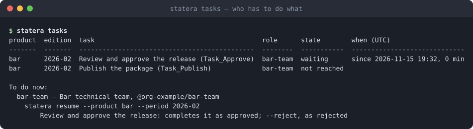
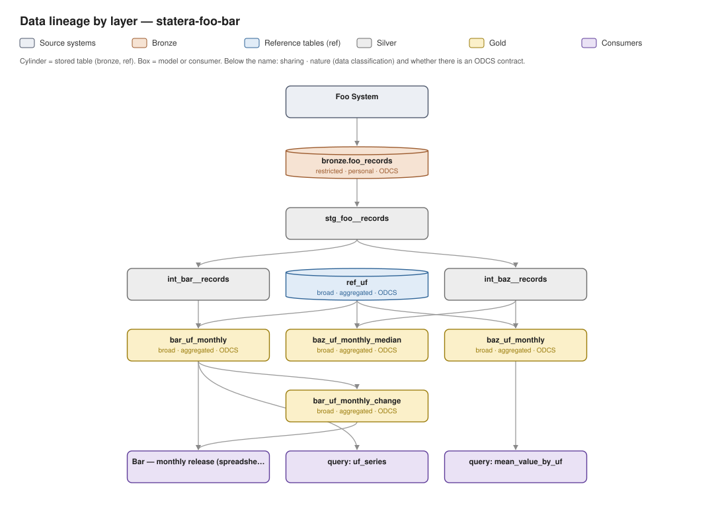
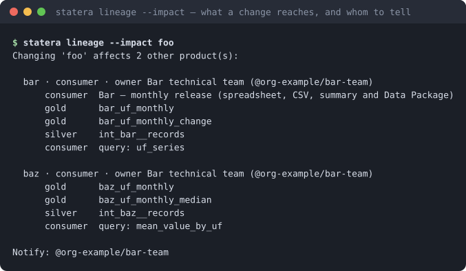
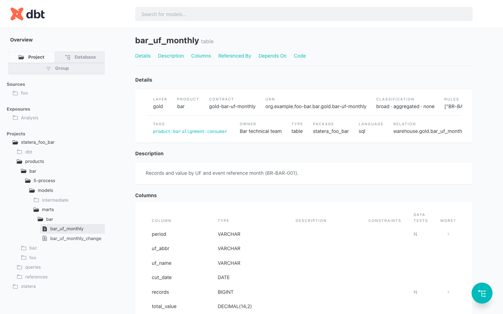
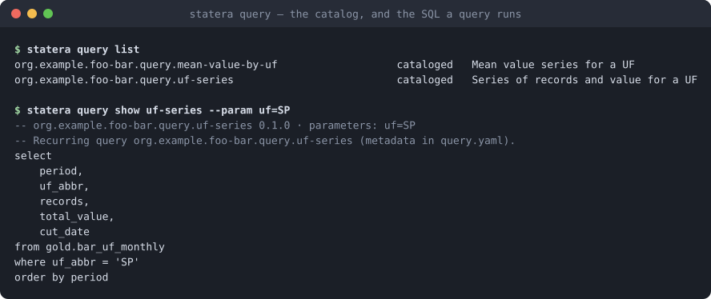

<p align="center">
  
</p>

# Statera

**Statera** is a standard and a framework for data product repositories, designed for statistical
products: data, rules, processes and publications organized as data products, with contracts,
information classification, an executable process, statistical disclosure control and a register of
every published edition.

> *Statera* is the Roman steelyard: a measuring instrument with a calibrated, public weight.

The framework is **generic**: it knows no product. Everything that belongs to an organization (products,
reference tables, queries, recipes, governance) lives in the organization's **data repository**, which
declares Statera as a dependency. An improvement to the framework reaches everyone through a version
upgrade.

```
SPECIFICATION   specification/               formats, profiles, namespace, classification, levels, cuts
     │ implemented by
FRAMEWORK       src/statera/                 Python package + CLI · dbt package · CI workflow · templates (Copier)
     │ used by
DATA            <org>/content/               products · references · queries · recipes · governance
REPOSITORY      <org>/publications/          register of published editions
```

**In this page:** [what it gives you](#what-it-gives-you) ·
[one edition, from the cut-off date to publication](#one-edition-from-the-cut-off-date-to-publication) ·
[why a standard inside a framework](#why-a-standard-inside-a-framework) ·
[installing](#installing) · [only reading the data](#only-reading-the-data) ·
[asking in plain language](#asking-in-plain-language-optional) · [starting a repository](#starting-a-data-repository) ·
[example](#example) · [command line](#command-line) · [library](#library) · [extending](#extending)

## What it gives you

Every image below comes from the example repository in [`examples/foo-bar/`](examples/foo-bar/content/README.md):
the diagrams are the files the framework generates there, and the terminals show what the commands printed.

### A process you can read, and that is what runs

Each product has one process, written in YAML that mirrors BPMN 2.0 (`2-design/process.yaml`). From it the
framework generates the `.bpmn` (it opens in Camunda Modeler or bpmn.io), this diagram and a viewer; and
`statera run` executes **that same process**: the automatic tasks run, the gateways follow the outcome, and
the edition stops at each human task until someone completes it. Every task carries its GSBPM sub-process
and its expected duration, so the diagram also says how much human work an edition takes.

<p align="center">
  
</p>

### Knowing who has to do what

The process stops at a human task and waits, even for days and on another computer. `statera status` says
where every product's edition is and which edition the calendar expects next; `statera tasks` is the work
list: the human tasks of every open edition, the role each belongs to, since when it waits, and the command
that takes it on.

<p align="center">
  
</p>

### Lineage, and what a change reaches

The lineage is not drawn by hand: it comes from the contracts, the dbt models and the declared consumers,
with the layer and the classification of every table. `statera lineage --impact` answers the question that
comes before a change: which products are downstream, and which team to tell.

<p align="center">
  
</p>
<p align="center">
  
</p>

### Documentation generated from the repository

`statera docs` writes the documentation from the metadata the repository already has: catalog, lineage,
processes, rules, series, queries, metrics, recipes and the conformance level of each product
([the example's](examples/foo-bar/content/docs/README.md)). `statera docs --interactive` adds a browsable,
searchable catalog in one page, where every table shows its layer, product, contract, URN, classification
and owner next to its columns and code.

<p align="center">
  
</p>

### A catalog of queries, with the SQL at hand

The questions people ask again and again become **cataloged queries**. Each one is a folder in
`queries/<theme>/<name>/` ([the example's](examples/foo-bar/content/queries/)) with its metadata
(`query.yaml`: what it returns, its parameters, its limitations, the classification of its output, its
owner), a test, and the SQL, written once over the products' tables and with the parameters as variables:

```sql
-- examples/foo-bar/content/queries/foo/uf-series/uf_series.sql
select
    period,
    uf_abbr,
    records,
    total_value,
    cut_date
from {{ ref('bar_uf_monthly') }}
where uf_abbr = '{{ var("uf", "SP") }}'
order by period
```

`statera query list` shows the catalog, and `statera query show <id> --param name=value` prints the SQL
**filled in**: the table resolved to where it really is and the parameters in place, ready to read, review
or paste into any SQL client.

<p align="center">
  
</p>

`statera query show <id> --help` describes a query (parameters, limitations, classification, owner), and
`statera query run <id> --param name=value` runs it; with `--output <folder>` it also writes the result and
its provenance (query version, parameters, engine, hash of the SQL).

### Asking in plain language

The command line grew with the standard. With the optional copilot, someone who knows the question and not
the command asks in their own words; a language model **running on their own computer** finds the cataloged
query or writes the SQL, which is checked before anyone sees it, explained on request and run only after a
yes ([more below](#asking-in-plain-language-optional)).

<p align="center">
  
</p>

### And, under all of it

- **Contracts for every table** (ODCS), checked against the data at every edition.
- **Information classification on every asset** and an open publication gate: a table is only published
  openly when its classification allows it, with statistical disclosure control (cell suppression,
  k-anonymity) applied where the table declares it.
- **Immutable cuts and a register of every published edition**: what was read, with which code version, and
  the hash of each file, so any published number can be reproduced and verified.
- **Business rules with executable cases**, in SQL and Python, and legacy SPSS and R code brought under the
  same process.
- **Quality indicators per edition**, with alerts that a person must acknowledge before approving.
- **A library to read it all** (Ibis): the catalog, the published editions, the cuts, and official metrics
  defined once.

## One edition, from the cut-off date to publication

This follows the February 2026 edition of the product `bar`, of the example, through every task of its
process: the machine's part, the two moments in which a person decides, and the publication. The outputs
are what the commands printed (`…` shortens a folder of this computer).

<p align="center">
  
</p>
<p align="center">
  
</p>

| In the diagram | Who | What happens |
|---|---|---|
| Calendar cut-off date | — | the edition starts: `statera run`, by a person or by the organization's scheduler |
| foo cut available | pipeline | the edition waits for the cut of the product it reads and pins it; with `--with-dependencies`, that cut is released first (extract, check the bronze contract, mark the cut) |
| Compute the product tables | pipeline | `dbt build`: the models and their tests |
| Check contracts and controls across editions | pipeline | the ODCS contracts against the data, then the product's controls; a failure takes the other way out of the gateway |
| Generate xlsx, summary and Data Package | pipeline | the edition package, with disclosure control applied |
| Review and approve the release | **a person** of `bar-team` | the process stops and waits for the decision |
| Publish the package | **a person** of `bar-team` | completing the task runs the publication and records the edition |
| Investigate the failure | **a person** of `bar-team` | only when a control fails: the edition is blocked there |

**1. The edition is started, and the machine goes as far as it can.**

```
$ statera run --product bar --period 2026-02 --with-dependencies
[statera] Edition bar 2026-02 — cut-off date 2026-03-10 — process products/bar/2-design/process.yaml
[statera]   cut 2026-03-10 pinned: foo (run 339f3fd0)
[statera] Task_Transform — Compute the product tables (dbt build)
[statera]   dbt build: PASS=11 WARN=0 ERROR=0 SKIP=0 NO-OP=0 REUSED=0 TOTAL=11
[statera] Task_Controls — Check contracts and controls across editions
[statera]   ODCS contracts: 19 checks on 3 contracts, at cut 2026-03-10
[statera]   [warning] CK-01 Revision of already released reference months: 6 key(s) revised beyond tolerance: records 34 -> 38 (11.8%); records 103 -> 123 (19.4%); records 23 -> 31 (34.8%)
[statera]   [ok] CK-02 No records lost between editions: 7 key(s) released before: none lost records
[statera] Task_Package — Generate xlsx, summary and Data Package
[statera]   package: …/data/products/bar/7-disseminate/2026-02 (version 1.0.0; 0 cells suppressed)
[statera] Awaiting 'Review and approve the release' (bar-team). Complete it with: statera resume
```

It stops at the first human task and saves its state: nothing is published yet, and the review can happen
tomorrow, on another computer. (The lines of the cut of `foo`, released first, are in the animation.)

**2. The team sees it is its turn, and looks at what was produced.** `statera tasks` lists the task for
`bar-team` with the command that completes it ([above](#knowing-who-has-to-do-what)); `statera status` says
how the edition got there, and the control that warned is what the reviewer has to judge:

```
$ statera status --product bar --period 2026-02
bar 2026-02 (cut-off date 2026-03-10): waiting, pending: Task_Approve
  Event_Cut              ok
  Task_Transform         ok
  Task_Controls          warning
  Task_Package           ok
```

The package to review is in the folder the run printed: `bar-2026-02.xlsx`, `by-uf.csv`,
`change-by-uf.csv`, `summary.md`, and its metadata, `datapackage.json` and `ckan.json`.

**3. A person approves.**

```
$ statera resume --product bar --period 2026-02
[statera] Task_Approve — Review and approve the release: approved
[statera] Awaiting 'Publish the package' (bar-team). Complete it with: statera resume
```

`statera resume --reject` records a rejection instead, and the process follows the "no" of the gateway,
back to the review. When the edition's evaluation has indicators in alert, approving requires
`--acknowledge-alerts "<why the edition goes on>"`, and the note is published with the edition.

**4. A person publishes.** The last task is semi-automatic: the person decides, the framework does it.

```
$ statera resume --product bar --period 2026-02
[statera] Task_Publish — Publish the package: approved
[statera]   registry: …/registry/bar/2026-02.datapackage.json (series page: …/registry/bar/README.md)
[statera] Edition bar 2026-02: done (Edition published).
```

**What is left.** The edition is in the editions register (in a data repository, the `publications/`
folder: [the example's](examples/foo-bar/publications/bar/)): its Data Package, with the hash of every
file, the cut it read and the version of the code that produced it; a line in the series index; and the
series page. `statera tasks --all` keeps what each human task decided, and when:

```
$ statera tasks --all --product bar
product  edition  task                                           role      state     when (UTC)
-------  -------  ---------------------------------------------  --------  --------  ----------------
bar      2026-01  Review and approve the release (Task_Approve)  bar-team  approved  2026-11-15 19:32
bar      2026-01  Publish the package (Task_Publish)             bar-team  approved  2026-11-15 19:32
bar      2026-02  Review and approve the release (Task_Approve)  bar-team  approved  2026-11-15 19:43
bar      2026-02  Publish the package (Task_Publish)             bar-team  approved  2026-11-15 19:43
```

### When the analysis stops the edition

The path above is the one in which everything goes well. The controls of phase 6 (Analyse) exist for the
other one. In the example, the synthetic source can reproduce an incident: the source system sends the
whole of January a second time, after the first edition was published.

```
$ statera synthetic --fault resent-january
Synthetic source foo/FooSystem: foo_records=1838 (injected fault: resent-january)
```

Nothing in the extraction or in the contracts can tell: the rows are valid. What notices is the control of
`bar` that compares each edition with the previous one (`CK-01`, in `6-analyse/controls.yaml`): January,
already published, would more than double.

<p align="center">
  
</p>

The gateway "Controls OK?" takes the "no": the package is not generated, the review is not reached, nothing
is published. The edition stays `blocked` at the exception task, with the failure recorded:

```
$ statera status --product bar --period 2026-02
bar 2026-02 (cut-off date 2026-03-10): blocked, pending: Task_Investigate
  Event_Cut              ok
  Task_Transform         ok
  Task_Controls          failed

Failures:
  - control CK-01 Revision of already released reference months: 7 key(s) revised beyond tolerance: records 55 -> 118 (114.5%); records 34 -> 77 (126.5%); records 103 -> 246 (138.8%)
```

and `statera tasks` puts the investigation on the team's list, ahead of the two tasks the edition did not
reach:

```
$ statera tasks
product  edition  task                                           role      state        when (UTC)
-------  -------  ---------------------------------------------  --------  -----------  -----------------------------
bar      2026-02  Investigate the failure (Task_Investigate)     bar-team  blocked      since 2026-11-15 19:51, 0 min
bar      2026-02  Review and approve the release (Task_Approve)  bar-team  not reached
bar      2026-02  Publish the package (Task_Publish)             bar-team  not reached

To do now:
  bar-team — Bar technical team, @org-example/bar-team
    statera run --product bar --period 2026-02
        Investigate the failure: runs it again, once what `statera status --product bar --period 2026-02` lists is fixed
```

A blocked edition cannot be approved around the control: `statera resume` refuses it.

```
$ statera resume --product bar --period 2026-02
[statera] EDITION NOT RESUMED
Edition bar 2026-02 is not awaiting a human task or an event (status: blocked). Once its failures are dealt with, run it again: statera run
```

**The correction is a change in the repository.** Batches and cuts are immutable, so the delivery that
came wrong is not erased: the team writes down what to do with it, as a business rule of the product
(`BR-BAR-003`, "a record counts once") with a case that proves it, implemented in the product's model:

```diff
 -- products/bar/5-process/models/intermediate/bar/int_bar__records.sql
+--   BR-BAR-003  a record counts once: a record the source sends again does not count again
+
+{{ config(meta={'rules': ['BR-BAR-003'], 'gsbpm': '5.4'}) }}
 
 select
     record_id,
     uf_id,
     period,
     value,
     cut_date
 from {{ ref('stg_foo__records') }}
+qualify row_number() over (partition by record_id order by received_at) = 1
```

```yaml
# products/bar/5-process/rules/BR-BAR-003-counts-once/cases.yaml
rule: BR-BAR-003
model: int_bar__records
variables: {period: "2026-02", cut_date: "2026-03-10"}
cases:
  - id: resent_record_counts_once
    description: R1 is received in January and sent again in February; R2 is received once.
    inputs:
      stg_foo__records:
        - {record_id: R1, uf_id: 35, period: "2026-01", value: 100.00, cut_date: "2026-03-10", received_at: "2026-01-20"}
        - {record_id: R1, uf_id: 35, period: "2026-01", value: 100.00, cut_date: "2026-03-10", received_at: "2026-02-20"}
        - {record_id: R2, uf_id: 35, period: "2026-01", value: 300.00, cut_date: "2026-03-10", received_at: "2026-01-25"}
    expected:
      - {record_id: R1, uf_id: 35, period: "2026-01", value: 100.00}
      - {record_id: R2, uf_id: 35, period: "2026-01", value: 300.00}
```

`statera sync` turns the case into a test that runs with the model, `statera check` validates the
repository with the new rule, and the change is reviewed like any other. The example is kept as it was
before this change, so that the incident can be reproduced; the whole change (the model, the rule and its
case) is in [`examples/foo-bar/incident/resent-january.patch`](examples/foo-bar/incident/resent-january.patch),
for `git apply`.

**Then the edition is run again**, from the start, through the same controls:

<p align="center">
  
</p>

The build now has one more test passing (the case of the new rule), `CK-01` is back to the warning any
edition gets (January is revised by what arrived late, as in the first path), and from there the edition is
like any other: it waits for the review, a person approves it, a person publishes it.

## Why a standard inside a framework

Statistical production already has good standards; what is usually missing is having them **together, in
one place, checked by a machine**. Statera invents no format where a standard exists: it adopts the
standard and defines only a profile on top of it.

| For… | Statera adopts | and adds, as a profile |
|---|---|---|
| the contract of every table | [ODCS](https://bitol-io.github.io/open-data-contract-standard/) v3.1 | layer, URN, classification, the dbt node that builds the table |
| the description of every product | [ODPS](https://bitol-io.github.io/open-data-product-standard/) v1.0 | alignment, visibility, authorized consumers, target conformance level |
| the production process | BPMN 2.0 | a YAML mirror that is also the execution plan; the type, GSBPM sub-process and duration of each task |
| the phases of the work | GSBPM 5.1 | the folders of every product (`1-specify` … `8-evaluate`) and the sub-process of every task |
| the transformations | [dbt](https://www.getdbt.com/) | the project and the tests of the business rules, generated from the products |
| what ran, on what | [OpenLineage](https://openlineage.io/) | the edition and the cut of every run |
| every published edition | [Data Package](https://datapackage.org/) 2.0 | the editions register: version, correction, hashes, code version |
| who answers for what | CODEOWNERS | generated from the roles and owners the repository declares |
| reading the data | [Ibis](https://ibis-project.org/) | one catalog over DuckDB, PostgreSQL, Trino, Athena and others |

What that buys:

- **One way of doing it, for every product.** A new product starts from a template, and someone who knows
  one product of the organization finds their way in any other: same folders, same files, same commands.
- **Checked, not promised.** `statera check` validates every product against the standard in CI, without
  data: contracts, classification, processes, rules, lineage. What the standard asks for is either there
  or the build says what is missing.
- **Adopted gradually.** Four conformance levels (catalogued, reproducible, controlled, evaluated) let a
  team start by describing what it publishes today, even a hand-built spreadsheet, and `statera conformance`
  says what is left for the next level.
- **Generated instead of kept by hand.** The dbt project, the tests of the business rules, the BPMN, the
  CODEOWNERS, the calendars of internal products and the documentation are generated from the same
  metadata, so they do not drift apart; for the first four, CI fails when the file is out of date.
- **An improvement reaches everyone.** The rules live in the framework, not copied into each repository:
  a repository pins a Statera version and gets the next one by upgrading it.
- **Standard files, other tools.** A contract, a process, a run event and an edition are files in open
  formats, which the tools made for those formats can read without Statera.
- **People's decisions stay people's, and recorded.** Approving and rejecting are tasks of the process,
  recorded with the decision and when it was made; an alert of the evaluation has to be acknowledged by
  someone, with a note, before an edition is approved. The automation never takes these over.

## Installing

Requires [uv](https://docs.astral.sh/uv/) and read access to this repository. Works the same on Windows,
Linux and Mac. What you install depends on what you do:

| You… | Install | Gets you |
|---|---|---|
| only **read** the data (analysts, other teams) | `statera` | catalog, queries, metrics, recipes, published editions |
| **produce** it (the data team) | `statera[produce]` | dbt (the process) and Copier (`init`, `new-product`) |
| keep products with legacy **R** code | `statera[legacy-r]` | reading and writing `.rds` (R itself is installed apart) |
| keep products with legacy **SPSS** code | `statera[legacy-spss]` | reading and writing `.sav` (GNU PSPP is installed apart) |
| read a shared PostgreSQL, Trino or Amazon Athena engine | `statera[postgres]`, `statera[trino]`, `statera[athena]` | the Ibis backend |
| want to **ask in plain language** instead of remembering commands | `statera[copilot]` | `statera copilot`, with a model that runs on your computer ([Ollama](https://ollama.com), installed apart) |

In a data repository you rarely choose: its `pyproject.toml` lists only what reading needs, and the
production tools as dependency groups (`produce`, `legacy-r`, `legacy-spss`) that the commands which produce
install by themselves. Someone who clones the repository to query it never downloads dbt. The copilot is a
group too (`copilot`), installed the first time someone runs `statera copilot`.

The global command (optional) is installed once per computer; the data team, who creates repositories,
installs it with the production tools:

```bash
uv tool install git+ssh://git@github.com/Jaimenms/statera.git                              # to read
uv tool install "statera[produce] @ git+ssh://git@github.com/Jaimenms/statera.git"         # to produce
uv tool upgrade statera                                                                     # later, rarely needed
```

The global `statera` command does almost nothing by itself: inside a data repository it finds the
repository root and hands the command off to the Statera version that repository pins
(`uv run --project <root> statera …`; uv updates the environment when needed, adding the production groups
only for the commands that produce). Every repository keeps its own version, and a computer never runs old
rules by accident. Outside a repository (`statera init`) it runs itself. `uv run statera …` works too, with
nothing installed globally; CI uses that form (`uv run --all-groups statera check --all`).

## Only reading the data

Inside a data repository (no production tools needed):

```bash
statera doctor                                   # says where the data is read from, or whom to ask
statera query list
statera query run uf-series --param uf=SP --output result/
```

The data comes from the shared engine the data team declares in `statera.toml` (`[consumption] engine`);
`STATERA_ENGINE` overrides it, for example with credentials. Statera opens a DuckDB file (on a share,
https:// or s3://) and any engine Ibis knows (PostgreSQL, Trino, Amazon Athena, MySQL, Snowflake…).
Any other source (MariaDB, H2, Parquet in a bucket, an internal API…) is an extension of the organization,
not of Statera: a **connector**, a function that receives the URL and returns an Ibis backend, declared in
`statera.toml` (`[consumption.connectors]`) or shipped in a package (entry point `statera.connectors`).
Published editions are read from the series' publication storage (`files_url`: a share or https:// by
itself; S3 and others through a **reader**, the same kind of extension), with every file checked against
the hash in the register. See [specification 07](specification/07-consumption.md).

## Asking in plain language (optional)

The command line grew with the standard. `statera copilot` is a way in for someone who knows the question
and not the command: a language model **running on your own computer** looks up the repository's catalog
and answers with the command to run, or, when nothing cataloged answers, with the SQL.

```bash
brew install ollama && ollama serve          # once: https://ollama.com/download (Windows: the installer)
ollama pull qwen2.5-coder:7b                 # once: the model, 4.7 GB
statera copilot "how many records did São Paulo have in 2026?"
statera copilot                              # a conversation: "and by month?", "now for Minas Gerais"
```

```
$ statera copilot "how many records did São Paulo have in 2026?"
  · choose: query:uf-series
  · query: {"uf": "SP"}
      ✘ it does not return what was asked (the query returns a monthly series for a UF; it has no year…)
  · choose: table:gold.bar_uf_monthly

  SELECT
    SUM(records) AS total_records
  FROM gold.bar_uf_monthly
  WHERE
    uf_abbr = 'SP' AND period LIKE '2026-%'
  · assumed: 2026 is every reference period starting with '2026-'
  · assumed: São Paulo is 'SP' in the uf_abbr column
  · reads: gold.bar_uf_monthly (ad hoc SQL: no cataloged query or metric answers this)
  Run it? [Y/n, e: edit, ?: explain]

 total_records
           412
```

- **Nothing leaves the computer.** The model is served by Ollama on `localhost`; Statera has no client for a
  hosted model and refuses an address that is not local.
- **What it proposes is checked, not trusted.** A command must be accepted by the real command line (the
  query, the metric and the product exist, the parameters are valid); SQL must be one read-only `SELECT` over
  cataloged tables you may read, accepted by the engine, filtering by values the data has. What fails goes
  back to the model, not to you.
- **It cannot name what does not exist.** The model chooses among the repository's own queries, metrics,
  tables and commands, and fills in only the parameters and options they declare.
- **It prefers what is cataloged**: a recurring query (reviewed, tested, with disclosure control) or an
  official metric when one returns exactly what was asked, SQL of its own otherwise.
- **It asks before running.** What only reads runs after a yes (`--yes` gives it in advance); what produces
  or changes asks every time; what records a person's decision (`resume`, `--approve`) or deletes (`clean`,
  `demo`) it shows and never runs.
- **You may ask what it does, or change it.** At that question, `?` explains the proposal part by part (each
  option, each filter) and `e` lets you edit it (↑ brings the line). What you write goes through the same
  checks, and an edit does not change who may run it.

It is a small model: it gets things wrong, which is why it shows what it assumed and what it read. A larger
local model answers better (`--model`, or `[copilot] model` in `statera.toml`). See
[specification 07](specification/07-consumption.md#copilot-optional).

## Starting a data repository

```bash
statera init my-org --name example-stats --namespace org.example --organization "Example statistics"
cd my-org
statera doctor      # checks the computer and the repository, and says how to fix each problem
statera check       # validation, lint and fast tests: the repository starts out valid
```

Then create the products with `statera new-product <name>`. The README generated in the repository
explains the day-to-day workflow; in VS Code the same commands are available as tasks.

## Example

[`examples/foo-bar/`](examples/foo-bar/content/README.md) is the smallest data repository that goes
through the whole cycle: a source-aligned product (`foo`), a dissemination product in SQL and pandas
(`bar`) and one computed by legacy SPSS and R code (`baz`).

```bash
cd examples/foo-bar
uv run statera demo
```

## What the framework does

| GSBPM phase | Module | What |
|---|---|---|
| 1 | `project`, `contracts`, `classification`, `governance` | Reads `statera.toml`, discovers the products; ODCS contracts; classification; generated CODEOWNERS |
| 2 | `design` | One process per product, in YAML mirroring BPMN 2.0 (`2-design/process.yaml`); generated `.bpmn`, SVG and viewer |
| 4 | `collect` | Incremental extraction in batches; immutable cuts with a manifest |
| 5 | `process` | dbt project generated from the products; rules with cases (SQL and Python); legacy code (SPSS via PSPP, R) |
| 6 | `analyse` | Contracts checked against the engine; controls; statistical disclosure control (cell suppression, k-anonymity) |
| 7 | `disseminate` | Edition package (CSV, xlsx, summary, Data Package, CKAN) and editions register |
| 8 | `evaluate` | Quality indicators and action plan; alerts acknowledged before approval, or blocking |
| — | `extend` | The public extension API: `Task`, `Check`, `Await` and `SyntheticSource`, the classes every process step extends (the framework's and the products') |
| — | `consume` | Library (Ibis): catalog, published editions, cuts, metrics, queries, recipes |
| — | `copilot` | Optional: plain-language questions answered with a checked command or SQL, by a local model |

## Command line

`statera init | doctor | check | new-product | sync | validate | conformance | run | resume | status |
tasks | cuts | synthetic | demo | query | metric | recipes | rules | contracts | lineage | evaluate | docs [--interactive] |
clean | copilot`. See `statera --help`. Commands work from any folder of a data repository.

`statera status` shows, for every product, where its latest edition (or cut) is in the BPMN process,
the role that has to act, the evaluation alerts and the next edition its calendar expects (with the
command to start the ones already due); `--product x` lists every edition of one product, and
`--product x --period y` details one edition.

`statera tasks` is the work list: the human tasks of every edition still open (not only the latest of
each product), the role each one belongs to, since when it waits and, under "To do now", the command that
takes each one on, by role. `--role x` shows one role's; `--all` adds the editions already done.

## Library

```python
from statera.consume import catalog

cat = catalog.open()  # the shared engine of statera.toml; engine="local" reads your own runs
cat.search(theme="formal-employment", layer="gold")
t = cat.table("gold.employment_flows_uf_monthly")  # Ibis table (current)
ed = cat.edition("employment-flows", "2026-06")  # what was published (local or files_url), hash verified
ed.table("net-change-by-uf")
ed.provenance
```

## Extending

A process names its steps by class: the framework's (`Extract`, `DbtBuild`, `Gate`, `Package`, `Publish`,
`Evaluate`, `MarkCut`, `PinCut`) or the product's own, written against `statera.extend` (stable from 0.6.0,
specification 05):

```python
from statera.extend import Check, CheckContext, CheckResult


class NoRecordsLost(Check):  # products/bar/6-analyse/checks.py, with cases in check-cases/NoRecordsLost.yaml
    """For every key released in the previous edition, the number of records must not decrease."""

    def evaluate(self, ctx: CheckContext) -> CheckResult: ...
```

`Task` and `Await` classes go in `<phase>/tasks.py`, `Check` classes in `6-analyse/checks.py` (listed in
`controls.yaml` and run by a `Gate`) and `SyntheticSource` classes in `3-build/synthetic.py`
(`statera synthetic`). Validation checks what the classes declare (GSBPM sub-process, tables, outcomes)
against the process and the contracts without running them.

## Development

```bash
uv sync && uv run pytest -q && uv run ruff check .   # the dev group includes every extra
```

The framework tests depend on no organization. CI also runs the `foo-bar` example end to end and, where
available, the SPSS syntax (GNU PSPP) and the R scripts.

## Specification

[specification/](specification/README.md): file formats, ODCS and ODPS profiles, namespace,
classification, processes, controls, consumption, conformance levels and internal products.

## License

[MIT](LICENSE). The JSON Schemas of the adopted standards in `src/statera/schemas/standards/` are copies of
the official ones and keep their own licenses.
