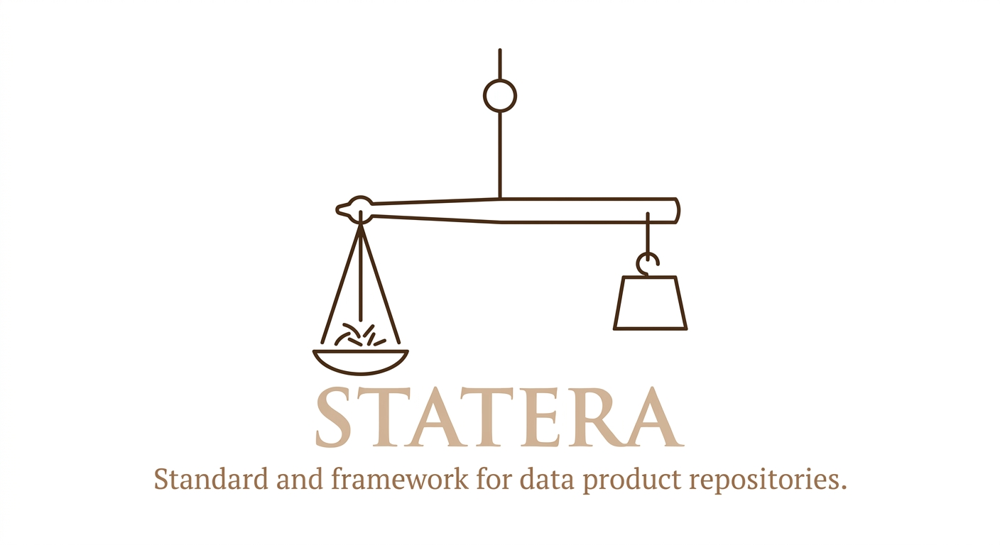

<p align="center">
  
</p>

# Statera

**Statera** is a standard and a framework for data product repositories, designed for statistical
products: data, rules, processes and publications organized as data products, with contracts,
information classification, an executable process, statistical disclosure control and a register of
every published edition.

> *Statera* is the Roman steelyard: a measuring instrument with a calibrated, public weight.

The framework is **generic**: it knows no product. Everything that belongs to an organization (products,
reference tables, queries, recipes, governance) lives in the organization's **data repository**, which
declares Statera as a dependency. An improvement to the framework reaches everyone through a version
upgrade.

```
SPECIFICATION   specification/               formats, profiles, namespace, classification, levels, cuts
     │ implemented by
FRAMEWORK       src/statera/                 Python package + CLI · dbt package · CI workflow · templates (Copier)
     │ used by
DATA            <org>/content/               products · references · queries · recipes · governance
REPOSITORY      <org>/publications/          register of published editions
```

## Installing

Requires [uv](https://docs.astral.sh/uv/) and read access to this repository. Works the same on Windows,
Linux and Mac. What you install depends on what you do:

| You… | Install | Gets you |
|---|---|---|
| only **read** the data (analysts, other teams) | `statera` | catalog, queries, metrics, recipes, published editions |
| **produce** it (the data team) | `statera[produce]` | dbt (the process) and Copier (`init`, `new-product`) |
| keep products with legacy **R** code | `statera[legacy-r]` | reading and writing `.rds` (R itself is installed apart) |
| keep products with legacy **SPSS** code | `statera[legacy-spss]` | reading and writing `.sav` (GNU PSPP is installed apart) |
| read a shared PostgreSQL, Trino or Amazon Athena engine | `statera[postgres]`, `statera[trino]`, `statera[athena]` | the Ibis backend |

In a data repository you rarely choose: its `pyproject.toml` lists only what reading needs, and the
production tools as dependency groups (`produce`, `legacy-r`, `legacy-spss`) that the commands which produce
install by themselves. Someone who clones the repository to query it never downloads dbt.

The global command (optional) is installed once per computer; the data team, who creates repositories,
installs it with the production tools:

```bash
uv tool install git+ssh://git@github.com/Jaimenms/statera.git                              # to read
uv tool install "statera[produce] @ git+ssh://git@github.com/Jaimenms/statera.git"         # to produce
uv tool upgrade statera                                                                     # later, rarely needed
```

The global `statera` command does almost nothing by itself: inside a data repository it finds the
repository root and hands the command off to the Statera version that repository pins
(`uv run --project <root> statera …`; uv updates the environment when needed, adding the production groups
only for the commands that produce). Every repository keeps its own version, and a computer never runs old
rules by accident. Outside a repository (`statera init`) it runs itself. `uv run statera …` works too, with
nothing installed globally; CI uses that form (`uv run --all-groups statera check --all`).

## Only reading the data

Inside a data repository (no production tools needed):

```bash
statera doctor                                   # says where the data is read from, or whom to ask
statera query list
statera query run uf-series --param uf=SP --output result/
```

The data comes from the shared engine the data team declares in `statera.toml` (`[consumption] engine`);
`STATERA_ENGINE` overrides it, for example with credentials. Statera opens a DuckDB file (on a share,
https:// or s3://) and any engine Ibis knows (PostgreSQL, Trino, Amazon Athena, MySQL, Snowflake…).
Any other source (MariaDB, H2, Parquet in a bucket, an internal API…) is an extension of the organization,
not of Statera: a **connector**, a function that receives the URL and returns an Ibis backend, declared in
`statera.toml` (`[consumption.connectors]`) or shipped in a package (entry point `statera.connectors`).
Published editions are read from the series' publication storage (`files_url`: a share or https:// by
itself; S3 and others through a **reader**, the same kind of extension), with every file checked against
the hash in the register. See [specification 07](specification/07-consumption.md).

## Starting a data repository

```bash
statera init my-org --name example-stats --namespace org.example --organization "Example statistics"
cd my-org
statera doctor      # checks the computer and the repository, and says how to fix each problem
statera check       # validation, lint and fast tests: the repository starts out valid
```

Then create the products with `statera new-product <name>`. The README generated in the repository
explains the day-to-day workflow; in VS Code the same commands are available as tasks.

## Example

[`examples/foo-bar/`](examples/foo-bar/content/README.md) is the smallest data repository that goes
through the whole cycle: a source-aligned product (`foo`), a dissemination product in SQL and pandas
(`bar`) and one computed by legacy SPSS and R code (`baz`).

```bash
cd examples/foo-bar
uv run statera demo
```

## What the framework does

| GSBPM phase | Module | What |
|---|---|---|
| 1 | `project`, `contracts`, `classification`, `governance` | Reads `statera.toml`, discovers the products; ODCS contracts; classification; generated CODEOWNERS |
| 2 | `design` | Process in YAML mirroring BPMN 2.0; generated `.bpmn`, SVG and viewer |
| 4 | `collect` | Incremental extraction in batches; immutable cuts with a manifest |
| 5 | `process` | dbt project generated from the products; rules with cases (SQL and Python); legacy code (SPSS via PSPP, R) |
| 6 | `analyse` | Contracts checked against the engine; controls; statistical disclosure control (cell suppression, k-anonymity) |
| 7 | `disseminate` | Edition package (CSV, xlsx, summary, Data Package, CKAN) and editions register |
| 8 | `evaluate` | Quality indicators and action plan; alerts acknowledged before approval, or blocking |
| — | `consume` | Library (Ibis): catalog, published editions, cuts, metrics, queries, recipes |

## Command line

`statera init | doctor | check | new-product | sync | validate | conformance | run | resume | status |
cuts | demo | query | metric | recipes | rules | contracts | lineage | evaluate | docs [--interactive] |
clean`. See `statera --help`. Commands work from any folder of a data repository.

`statera status` shows, for every product, where its latest edition (or cut) is in the BPMN process,
the role that has to act and the evaluation alerts; `--product x` lists every edition of one product,
and `--product x --period y` details one edition.

## Library

```python
from statera.consume import catalog

cat = catalog.open()  # the shared engine of statera.toml; engine="local" reads your own runs
cat.search(theme="formal-employment", layer="gold")
t = cat.table("gold.employment_flows_uf_monthly")  # Ibis table (current)
ed = cat.edition("employment-flows", "2026-06")  # what was published (local or files_url), hash verified
ed.table("net-change-by-uf")
ed.provenance
```

## Development

```bash
uv sync && uv run pytest -q && uv run ruff check .   # the dev group includes every extra
```

The framework tests depend on no organization. CI also runs the `foo-bar` example end to end and, where
available, the SPSS syntax (GNU PSPP) and the R scripts.

## Specification

[specification/](specification/README.md): file formats, ODCS and ODPS profiles, namespace,
classification, processes, controls, consumption, conformance levels and internal products.
