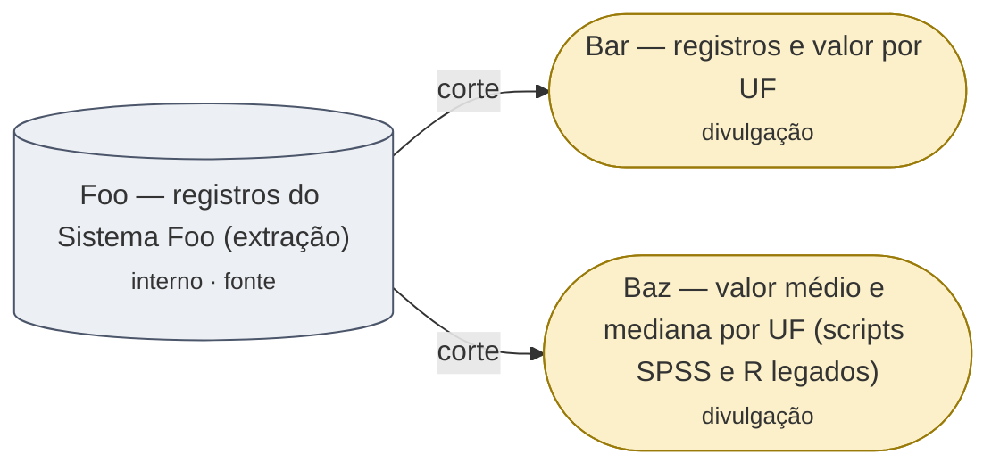

# Catálogo de dados

> ARQUIVO GERADO pela plataforma Statera. Não edite à mão: a próxima geração desfaz a mudança.  
> Gerado por `statera docs`. Fontes: metadados do repositório (contratos, produtos, processos, regras, séries).  
> Para mudar: edite as fontes e rode `statera docs`.  
> **Exemplo com DADOS SINTÉTICOS.**

## Produtos e os cinco eixos do edital

O item 13 do edital pede organização por **tema, produto, base, periodicidade e finalidade**. Os eixos vêm do descritor ODPS de cada produto. Produtos **internos** (alinhados à fonte ou agregados) não são divulgados: liberam **cortes** para os consumidores autorizados. O **nível** é o de conformidade atingido (1 catalogado a 4 avaliado; detalhes em [conformidade](conformance.md)).

| Produto | Tipo | Nível | Identificador | Domínio | Lê os cortes de | Tema | Bases | Periodicidade | Finalidade |
|---|---|---|---|---|---|---|---|---|---|
| [Bar — registros e valor por UF](../products/bar/1-specify/product.odps.yaml) | divulgação | 3 — controlado | `br.gov.foo-bar.bar` | foo | foo | foo | sistema-foo | monthly | official-release |
| [Baz — valor médio e mediana por UF (scripts SPSS e R legados)](../products/baz/1-specify/product.odps.yaml) | divulgação | 2 — reprodutível | `br.gov.foo-bar.baz` | foo | foo | foo | sistema-foo | monthly | official-release |
| [Foo — registros do Sistema Foo (extração)](../products/foo/1-specify/product.odps.yaml) | interno · fonte | 3 — controlado | `br.gov.foo-bar.foo` | foo | — |  |  | por corte |  |

### Malha de produtos

## Como acessar

Onde o público encontra cada produto de divulgação. As **distribuições** são os arquivos (no vocabulário do DCAT): as de produtos com série saem do processo a cada edição e ficam registradas, com hash, no registro de edições; as de produtos de nível 1 são declaradas no descritor ODPS (`distribuicoes`), porque ainda são produzidas fora do processo.

| Produto | Distribuição | Formato | Atualização | Última edição | Origem |
|---|---|---|---|---|---|
| Bar — registros e valor por UF | [Planilha (bar-2026-02.xlsx)](https://example.org/foo-bar/bar) | xlsx | monthly | [2026-02](../../publications/bar/2026-02.datapackage.json) | gerada a cada edição |
| Bar — registros e valor por UF | [Tabelas (2 arquivos CSV)](https://example.org/foo-bar/bar) | csv | monthly | [2026-02](../../publications/bar/2026-02.datapackage.json) | gerada a cada edição |
| Baz — valor médio e mediana por UF (scripts SPSS e R legados) | [Planilha (baz-AAAA-MM.xlsx)](https://example.org/foo-bar/baz) | xlsx | monthly |  | gerada a cada edição |
| Baz — valor médio e mediana por UF (scripts SPSS e R legados) | [Tabelas (2 arquivos CSV)](https://example.org/foo-bar/baz) | csv | monthly |  | gerada a cada edição |

## Quem pode ler os produtos internos

Produtos internos guardam dado restrito, inclusive pessoal. Quem lê está declarado no produto (`authorizedConsumers`), sempre com a finalidade. Uma **equipe** que não é a dona lê no ambiente do órgão, até a data autorizada e com o ato que autorizou; vencido o prazo, o CI falha até a autorização ser renovada ou retirada. Fora dessas autorizações, o caminho é uma consulta catalogada (saída agregada, com controle de divulgação) ou os microdados não identificados.

| Produto interno | Quem | Tipo | Finalidade | Até | Vigente | Ato |
|---|---|---|---|---|---|---|
| Foo — registros do Sistema Foo (extração) | `bar` | product | estatística mensal de registros e valor por UF | — | — |  |
| Foo — registros do Sistema Foo (extração) | `baz` | product | valor médio por UF pelo script SPSS legado | — | — |  |

## Referências no tempo

Cada referência declara a temporalidade: **estavel**; **vigencia** (cada linha vale num intervalo, e as junções usam a data do evento); **versao** (versões publicadas pela autoridade, fixadas pelo consumidor, com tabela de correspondência entre versões). Toda edição registra a versão e o hash de cada referência usada.

| Referência | Versão do contrato | Temporalidade | Autoridade | Nota |
|---|---|---|---|---|
| [Unidades da Federação](../references/uf/ref_uf.odcs.yaml) | 1.0.0 | stable | IBGE |  |

## Ativos por camada

### Bronze

| Ativo | Unidade | Propósito | Classificação | Dono | Contrato |
|---|---|---|---|---|---|
| `bronze.foo_registros` | foo | Registros do Sistema Foo, um por solicitação, guardados uma vez no lote em que foram extraídos. | restricted · personal · other | equipe-dados | [bronze-foo-registros](../products/foo/4-collect/contracts/foo_registros.odcs.yaml) |

### Referências (ref)

| Ativo | Unidade | Propósito | Classificação | Dono | Contrato |
|---|---|---|---|---|---|
| `ref.ref_uf` | uf | Unidades da Federação e grandes regiões, com os códigos do IBGE. | broad · aggregated · none | curadoria | [ref-uf](../references/uf/ref_uf.odcs.yaml) |

### Gold

| Ativo | Unidade | Propósito | Classificação | Dono | Contrato |
|---|---|---|---|---|---|
| `gold.bar_uf_mensal` | bar | Registros e valor por UF e competência do fato (RN-BAR-001). | broad · aggregated · none | equipe-bar | [gold-bar-uf-mensal](../products/bar/5-process/contracts/bar_uf_mensal.odcs.yaml) |
| `gold.bar_variacao_uf_mensal` | bar | Variação percentual de registros de cada UF em relação à competência anterior (RN-BAR-002). | broad · aggregated · none | equipe-bar | [gold-bar-variacao-uf-mensal](../products/bar/5-process/contracts/bar_variacao_uf_mensal.odcs.yaml) |
| `gold.baz_mediana_uf_mensal` | baz | Mediana do valor dos registros por UF e competência (RN-BAZ-002), pelo script R legado. | broad · aggregated · none | equipe-bar | [gold-baz-mediana-uf-mensal](../products/baz/5-process/contracts/baz_mediana_uf_mensal.odcs.yaml) |
| `gold.baz_uf_mensal` | baz | Valor médio dos registros por UF e competência (RN-BAZ-001), pelo script SPSS legado. | broad · aggregated · none | equipe-bar | [gold-baz-uf-mensal](../products/baz/5-process/contracts/baz_uf_mensal.odcs.yaml) |

## Detalhe dos contratos

### Foo — registros (bronze)

`br.gov.foo-bar.foo.bronze.foo-registros` · `bronze-foo-registros` · versão 1.0.0 · [arquivo do contrato](../products/foo/4-collect/contracts/foo_registros.odcs.yaml)

- **Classificação:** restricted · personal · other
- **Granularidade:** Uma linha por registro, guardada uma vez, no lote em que foi extraída
- **Limitações:** Pode haver registros recebidos depois do corte; eles entram no corte seguinte.

| Coluna | Tipo | Obrigatória | Compartilhamento | Dado pessoal | Descrição |
|---|---|---|---|---|---|
| `id_registro` | string | sim | restricted |  |  |
| `id_pessoa` | string | sim | specific | personal |  |
| `cod_uf` | integer | sim | restricted |  |  |
| `data_fato` | date | sim | restricted |  |  |
| `data_recepcao` | timestamp | sim | restricted |  |  |
| `valor` | number | sim | restricted |  |  |
| `batch` | integer | sim | restricted |  | Lote da extração incremental. |

**Regras de qualidade:**
- `linhas_presentes`: rowCount

### Bar — registros e valor por UF e competência

`br.gov.foo-bar.bar.gold.bar-uf-mensal` · `gold-bar-uf-mensal` · versão 1.0.0 · [arquivo do contrato](../products/bar/5-process/contracts/bar_uf_mensal.odcs.yaml)

- **Classificação:** broad · aggregated · none
- **Granularidade:** Uma linha por competência e UF com registros
- **Limitações:** Competências recentes mudam entre edições. DADOS SINTÉTICOS.

| Coluna | Tipo | Obrigatória | Compartilhamento | Dado pessoal | Descrição |
|---|---|---|---|---|---|
| `competencia` | string | sim | broad |  |  |
| `sigla_uf` | string | sim | broad |  |  |
| `nome_uf` | string |  | broad |  |  |
| `data_corte` | date | sim | broad |  |  |
| `registros` | integer | sim | broad |  |  |
| `valor_total` | number | sim | broad |  |  |
| `valor_medio` | number |  | broad |  |  |

**Regras de qualidade:**
- `linhas_presentes`: rowCount

### Bar — variação de registros por UF sobre o mês anterior

`br.gov.foo-bar.bar.gold.bar-variacao-uf-mensal` · `gold-bar-variacao-uf-mensal` · versão 1.0.0 · [arquivo do contrato](../products/bar/5-process/contracts/bar_variacao_uf_mensal.odcs.yaml)

- **Classificação:** broad · aggregated · none
- **Granularidade:** Uma linha por competência e UF com registros
- **Limitações:** Vazia na primeira competência de cada UF. DADOS SINTÉTICOS.

| Coluna | Tipo | Obrigatória | Compartilhamento | Dado pessoal | Descrição |
|---|---|---|---|---|---|
| `competencia` | string | sim | broad |  |  |
| `sigla_uf` | string | sim | broad |  |  |
| `data_corte` | date | sim | broad |  |  |
| `registros` | integer | sim | broad |  |  |
| `registros_mes_anterior` | number |  | broad |  |  |
| `variacao_pct` | number |  | broad |  |  |

**Regras de qualidade:**
- `linhas_presentes`: rowCount

### Baz — mediana do valor por UF e competência

`br.gov.foo-bar.baz.gold.baz-mediana-uf-mensal` · `gold-baz-mediana-uf-mensal` · versão 0.1.0 · [arquivo do contrato](../products/baz/5-process/contracts/baz_mediana_uf_mensal.odcs.yaml)

- **Classificação:** broad · aggregated · none
- **Granularidade:** Uma linha por competência e UF com registros
- **Limitações:** Calculada pelo script R legado, ainda não reescrito. DADOS SINTÉTICOS.

| Coluna | Tipo | Obrigatória | Compartilhamento | Dado pessoal | Descrição |
|---|---|---|---|---|---|
| `competencia` | string | sim | broad |  |  |
| `sigla_uf` | string | sim | broad |  |  |
| `data_corte` | date | sim | broad |  |  |
| `valor_mediano` | number |  | broad |  |  |

**Regras de qualidade:**
- `linhas_presentes`: rowCount

### Baz — valor médio por UF e competência

`br.gov.foo-bar.baz.gold.baz-uf-mensal` · `gold-baz-uf-mensal` · versão 0.1.0 · [arquivo do contrato](../products/baz/5-process/contracts/baz_uf_mensal.odcs.yaml)

- **Classificação:** broad · aggregated · none
- **Granularidade:** Uma linha por competência e UF com registros
- **Limitações:** Calculada pelo PSPP; equivalência com o SPSS a certificar. DADOS SINTÉTICOS.

| Coluna | Tipo | Obrigatória | Compartilhamento | Dado pessoal | Descrição |
|---|---|---|---|---|---|
| `competencia` | string | sim | broad |  |  |
| `sigla_uf` | string | sim | broad |  |  |
| `data_corte` | date | sim | broad |  |  |
| `registros` | integer | sim | broad |  |  |
| `valor_medio` | number |  | broad |  |  |

**Regras de qualidade:**
- `linhas_presentes`: rowCount

### Unidades da Federação

`br.gov.foo-bar.uf.ref.ref-uf` · `ref-uf` · versão 1.0.0 · [arquivo do contrato](../references/uf/ref_uf.odcs.yaml)

- **Classificação:** broad · aggregated · none
- **Granularidade:** 
- **Limitações:** Cópia local; a fonte oficial é o IBGE.

| Coluna | Tipo | Obrigatória | Compartilhamento | Dado pessoal | Descrição |
|---|---|---|---|---|---|
| `cod_uf` | integer | sim | broad |  |  |
| `sigla_uf` | string | sim | broad |  |  |
| `nome_uf` | string | sim | broad |  |  |
| `cod_regiao` | integer | sim | broad |  |  |
| `regiao` | string | sim | broad |  |  |

**Regras de qualidade:**
- `linhas_presentes`: rowCount
