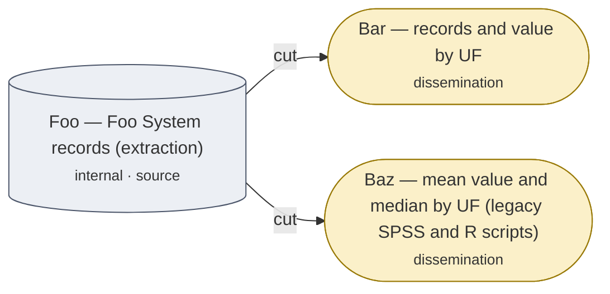

# Data catalog

> GENERATED FILE by the Statera framework. Do not edit by hand: the next generation undoes the change.  
> Generated by `statera docs`. Sources: repository metadata (contracts, products, processes, rules, series).  
> To change it: edit the sources and run `statera docs`.  
> **Example with SYNTHETIC DATA.**

## Products and the five organizing axes

The catalog is organized by **theme, product, base, frequency and purpose**. The axes come from each product's ODPS descriptor. **Internal** products (source-aligned or aggregate) are not disseminated: they release **cuts** to the authorized consumers. The **level** is the conformance level achieved (1 cataloged to 4 evaluated; details in [conformance](conformance.md)).

| Product | Kind | Level | Identifier | Domain | Reads the cuts of | Theme | Bases | Frequency | Purpose |
|---|---|---|---|---|---|---|---|---|---|
| [Bar — records and value by UF](../products/bar/1-specify/product.odps.yaml) | dissemination | 3 — controlled | `org.example.foo-bar.bar` | foo | foo | foo | foo-system | monthly | official-release |
| [Baz — mean value and median by UF (legacy SPSS and R scripts)](../products/baz/1-specify/product.odps.yaml) | dissemination | 2 — reproducible | `org.example.foo-bar.baz` | foo | foo | foo | foo-system | monthly | official-release |
| [Foo — Foo System records (extraction)](../products/foo/1-specify/product.odps.yaml) | internal · source | 3 — controlled | `org.example.foo-bar.foo` | foo | — |  |  | per cut |  |

### Product mesh

## How to access

Where the public finds each dissemination product. **Distributions** are the files (in DCAT vocabulary): those of products with a series come out of the process with each edition and are recorded, with a hash, in the editions register; those of level 1 products are declared in the ODPS descriptor (`distributions`), because they are still produced outside the process.

| Product | Distribution | Format | Updated | Latest edition | Origin |
|---|---|---|---|---|---|
| Bar — records and value by UF | [Spreadsheet (bar-2026-02.xlsx)](https://example.org/foo-bar/bar) | xlsx | monthly | [2026-02](../../publications/bar/2026-02.datapackage.json) | generated with each edition |
| Bar — records and value by UF | [Tables (2 CSV files)](https://example.org/foo-bar/bar) | csv | monthly | [2026-02](../../publications/bar/2026-02.datapackage.json) | generated with each edition |
| Baz — mean value and median by UF (legacy SPSS and R scripts) | [Spreadsheet (baz-YYYY-MM.xlsx)](https://example.org/foo-bar/baz) | xlsx | monthly |  | generated with each edition |
| Baz — mean value and median by UF (legacy SPSS and R scripts) | [Tables (2 CSV files)](https://example.org/foo-bar/baz) | csv | monthly |  | generated with each edition |

## Who may read the internal products

Internal products hold restricted data, including personal data. Who reads them is declared in the product (`authorizedConsumers`), always with the purpose. A **team** that is not the owner reads in the organization's environment, until the authorized date and with the act that authorized it; once the term expires, CI fails until the authorization is renewed or withdrawn. Outside these authorizations, the path is a cataloged query (aggregated output, with disclosure control) or the deidentified microdata.

| Internal product | Who | Kind | Purpose | Until | Current | Act |
|---|---|---|---|---|---|---|
| Foo — Foo System records (extraction) | `bar` | product | monthly statistics of records and value by UF | — | — |  |
| Foo — Foo System records (extraction) | `baz` | product | mean value by UF from the legacy SPSS script | — | — |  |

## Reference tables over time

Each reference table declares its temporality: **stable**; **validity** (each row is valid over an interval, and joins use the event date); **versioned** (versions published by the authority, pinned by the consumer, with a correspondence table between versions). Every edition records the version and hash of each reference table used.

| Reference table | Contract version | Temporality | Authority | Note |
|---|---|---|---|---|
| [Federative Units](../references/uf/ref_uf.odcs.yaml) | 1.0.0 | stable | IBGE |  |

## Assets by layer

### Bronze

| Asset | Unit | Purpose | Classification | Owner | Contract |
|---|---|---|---|---|---|
| `bronze.foo_records` | foo | Foo System records, one per request, stored once in the batch in which they were extracted. | restricted · personal · other | data-team | [bronze-foo-records](../products/foo/4-collect/contracts/foo_records.odcs.yaml) |

### Reference tables (ref)

| Asset | Unit | Purpose | Classification | Owner | Contract |
|---|---|---|---|---|---|
| `ref.ref_uf` | uf | Federative Units (UFs) and major regions, with IBGE codes. | broad · aggregated · none | curation | [ref-uf](../references/uf/ref_uf.odcs.yaml) |

### Gold

| Asset | Unit | Purpose | Classification | Owner | Contract |
|---|---|---|---|---|---|
| `gold.bar_uf_monthly` | bar | Records and value by UF and event reference month (BR-BAR-001). | broad · aggregated · none | bar-team | [gold-bar-uf-monthly](../products/bar/5-process/contracts/bar_uf_monthly.odcs.yaml) |
| `gold.bar_uf_monthly_change` | bar | Percentage change in records of each UF relative to the previous reference month (BR-BAR-002). | broad · aggregated · none | bar-team | [gold-bar-uf-monthly-change](../products/bar/5-process/contracts/bar_uf_monthly_change.odcs.yaml) |
| `gold.baz_uf_monthly` | baz | Mean value of records by UF and reference month (BR-BAZ-001), from the legacy SPSS script. | broad · aggregated · none | bar-team | [gold-baz-uf-monthly](../products/baz/5-process/contracts/baz_uf_monthly.odcs.yaml) |
| `gold.baz_uf_monthly_median` | baz | Median value of records by UF and reference month (BR-BAZ-002), from the legacy R script. | broad · aggregated · none | bar-team | [gold-baz-uf-monthly-median](../products/baz/5-process/contracts/baz_uf_monthly_median.odcs.yaml) |

## Contract details

### Foo — records (bronze)

`org.example.foo-bar.foo.bronze.foo-records` · `bronze-foo-records` · version 1.0.0 · [contract file](../products/foo/4-collect/contracts/foo_records.odcs.yaml)

- **Classification:** restricted · personal · other
- **Granularity:** One row per record, stored once, in the batch in which it was extracted
- **Limitations:** Some records may be received after the cut; they go into the next cut.

| Column | Type | Required | Sharing | Personal data | Description |
|---|---|---|---|---|---|
| `record_id` | string | yes | restricted |  |  |
| `person_id` | string | yes | specific | personal |  |
| `uf_id` | integer | yes | restricted |  |  |
| `event_date` | date | yes | restricted |  |  |
| `received_at` | timestamp | yes | restricted |  |  |
| `value` | number | yes | restricted |  |  |
| `batch` | integer | yes | restricted |  | Incremental extraction batch. |

**Quality rules:**
- `rows_present`: rowCount

### Bar — records and value by UF and reference month

`org.example.foo-bar.bar.gold.bar-uf-monthly` · `gold-bar-uf-monthly` · version 1.0.0 · [contract file](../products/bar/5-process/contracts/bar_uf_monthly.odcs.yaml)

- **Classification:** broad · aggregated · none
- **Granularity:** One row per reference month and UF with records
- **Limitations:** Recent reference months change between editions. SYNTHETIC DATA.

| Column | Type | Required | Sharing | Personal data | Description |
|---|---|---|---|---|---|
| `period` | string | yes | broad |  |  |
| `uf_abbr` | string | yes | broad |  |  |
| `uf_name` | string |  | broad |  |  |
| `cut_date` | date | yes | broad |  |  |
| `records` | integer | yes | broad |  |  |
| `total_value` | number | yes | broad |  |  |
| `mean_value` | number |  | broad |  |  |

**Quality rules:**
- `rows_present`: rowCount

### Bar — month-over-month change in records by UF

`org.example.foo-bar.bar.gold.bar-uf-monthly-change` · `gold-bar-uf-monthly-change` · version 1.0.0 · [contract file](../products/bar/5-process/contracts/bar_uf_monthly_change.odcs.yaml)

- **Classification:** broad · aggregated · none
- **Granularity:** One row per reference month and UF with records
- **Limitations:** Empty in the first reference month of each UF. SYNTHETIC DATA.

| Column | Type | Required | Sharing | Personal data | Description |
|---|---|---|---|---|---|
| `period` | string | yes | broad |  |  |
| `uf_abbr` | string | yes | broad |  |  |
| `cut_date` | date | yes | broad |  |  |
| `records` | integer | yes | broad |  |  |
| `previous_month_records` | number |  | broad |  |  |
| `change_pct` | number |  | broad |  |  |

**Quality rules:**
- `rows_present`: rowCount

### Baz — mean value by UF and reference month

`org.example.foo-bar.baz.gold.baz-uf-monthly` · `gold-baz-uf-monthly` · version 0.1.0 · [contract file](../products/baz/5-process/contracts/baz_uf_monthly.odcs.yaml)

- **Classification:** broad · aggregated · none
- **Granularity:** One row per reference month and UF with records
- **Limitations:** Computed by PSPP; equivalence with SPSS yet to be certified. SYNTHETIC DATA.

| Column | Type | Required | Sharing | Personal data | Description |
|---|---|---|---|---|---|
| `period` | string | yes | broad |  |  |
| `uf_abbr` | string | yes | broad |  |  |
| `cut_date` | date | yes | broad |  |  |
| `records` | integer | yes | broad |  |  |
| `mean_value` | number |  | broad |  |  |

**Quality rules:**
- `rows_present`: rowCount

### Baz — median value by UF and reference month

`org.example.foo-bar.baz.gold.baz-uf-monthly-median` · `gold-baz-uf-monthly-median` · version 0.1.0 · [contract file](../products/baz/5-process/contracts/baz_uf_monthly_median.odcs.yaml)

- **Classification:** broad · aggregated · none
- **Granularity:** One row per reference month and UF with records
- **Limitations:** Computed by the legacy R script, not rewritten yet. SYNTHETIC DATA.

| Column | Type | Required | Sharing | Personal data | Description |
|---|---|---|---|---|---|
| `period` | string | yes | broad |  |  |
| `uf_abbr` | string | yes | broad |  |  |
| `cut_date` | date | yes | broad |  |  |
| `median_value` | number |  | broad |  |  |

**Quality rules:**
- `rows_present`: rowCount

### Federative Units

`org.example.foo-bar.uf.ref.ref-uf` · `ref-uf` · version 1.0.0 · [contract file](../references/uf/ref_uf.odcs.yaml)

- **Classification:** broad · aggregated · none
- **Granularity:** 
- **Limitations:** Local copy; the official source is IBGE.

| Column | Type | Required | Sharing | Personal data | Description |
|---|---|---|---|---|---|
| `uf_id` | integer | yes | broad |  |  |
| `uf_abbr` | string | yes | broad |  |  |
| `uf_name` | string | yes | broad |  |  |
| `region_id` | integer | yes | broad |  |  |
| `region` | string | yes | broad |  |  |

**Quality rules:**
- `rows_present`: rowCount
