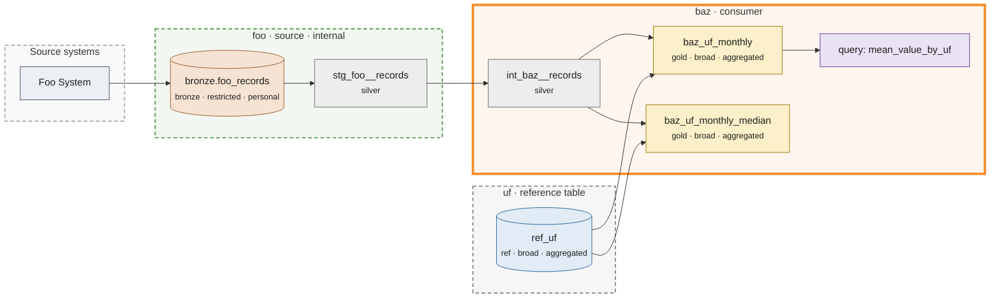

# Lineage — baz

> GENERATED FILE by the Statera framework. Do not edit by hand: the next generation undoes the change.  
> Generated by `statera docs`. Sources: repository metadata (contracts, products, processes, rules, series).  
> To change it: edit the sources and run `statera docs`.  
> **Example with SYNTHETIC DATA.**

Baz — mean value and median by UF (legacy SPSS and R scripts) · consumer · owner Bar technical team (`@org-example/bar-team`). [All products](../lineage.md).

## Reads

source system Foo System; product [foo](foo.md); reference table `uf`.

## Impact of a change

What is downstream of `baz` (`statera lineage --impact baz`).

Nothing reads this product.
