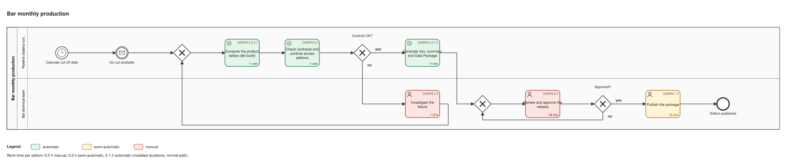
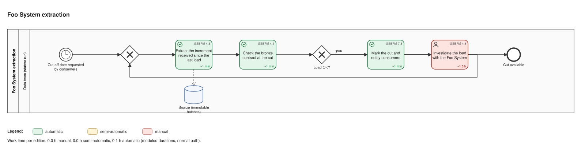

# Processes (BPMN 2.0 annotated with GSBPM)

> GENERATED FILE by the Statera framework. Do not edit by hand: the next generation undoes the change.  
> Generated by `statera docs`. Sources: repository metadata (contracts, products, processes, rules, series).  
> To change it: edit the sources and run `statera docs`.  
> **Example with SYNTHETIC DATA.**

Each product has **one process**, a **YAML mirror of BPMN 2.0** in `<product>/2-design/process.yaml`. `statera bpmn` generates the standard `.bpmn` (Camunda Modeler, bpmn.io, VS Code extension) and the images below. The process is also the **execution plan**: `statera run` walks the flows, runs the automatic tasks and stops at the human ones.

## Effort per edition

| Process | Tasks | Manual | Semi-automatic | Automatic | Total |
|---|---|---|---|---|---|
| Bar monthly production | 6 | 0.5 h | 0.2 h | 0.05 h | 0.7 h |
| Foo System extraction | 4 | 0.0 h | 0.0 h | 0.05 h | 0.1 h |

Modeled durations (`statera:durationMin`), on the normal path, without exception tasks. The observed duration is on the series page in the editions register.

## Bar monthly production

Source: [process.yaml](../products/bar/2-design/process.yaml) · generated: [process.bpmn](../products/bar/2-design/process.bpmn) · [interactive viewer](../products/bar/2-design/process.html)

| Task | Lane (role) | Kind | GSBPM | Duration | Implementation |  |
|---|---|---|---|---|---|---|
| Compute the product tables (dbt build) | Pipeline (statera run) | automatic | 5.3-5.7 | 1 min | `DbtBuild` |  |
| Check contracts and controls across editions | Pipeline (statera run) | automatic | 6.2 | 1 min | `Gate` |  |
| Generate xlsx, summary and Data Package | Pipeline (statera run) | automatic | 6.4;7.2 | 1 min | `Package` |  |
| Investigate the failure | Bar technical team | manual | 5.3 | 60 min |  | exception |
| Review and approve the release | Bar technical team | manual | 6.5 | 30 min |  |  |
| Publish the package | Bar technical team | semi-automatic | 7.3 | 10 min | `Publish` |  |

## Foo System extraction

Source: [process.yaml](../products/foo/2-design/process.yaml) · generated: [process.bpmn](../products/foo/2-design/process.bpmn) · [interactive viewer](../products/foo/2-design/process.html)

| Task | Lane (role) | Kind | GSBPM | Duration | Implementation |  |
|---|---|---|---|---|---|---|
| Extract the increment received since the last load | Data team (statera run) | automatic | 4.3 | 1 min | `Extract` |  |
| Check the bronze contract at the cut | Data team (statera run) | automatic | 4.4 | 1 min | `Gate` |  |
| Mark the cut and notify consumers | Data team (statera run) | automatic | 7.3 | 1 min | `MarkCut` |  |
| Investigate the load with the Foo System | Data team (statera run) | manual | 4.3 | 60 min |  | exception |
