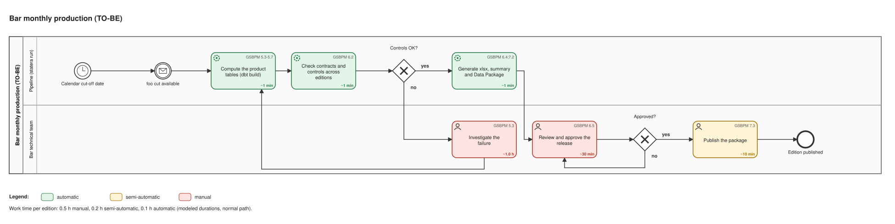
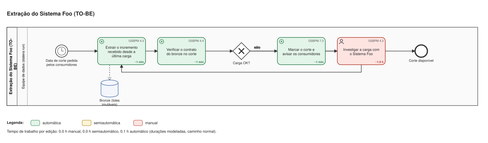

# Processos (BPMN 2.0 anotado com GSBPM)

> ARQUIVO GERADO pela plataforma Statera. Não edite à mão: a próxima geração desfaz a mudança.  
> Gerado por `statera docs`. Fontes: metadados do repositório (contratos, produtos, processos, regras, séries).  
> Para mudar: edite as fontes e rode `statera docs`.  
> **Exemplo com DADOS SINTÉTICOS.**

A fonte de cada processo é um **YAML espelho do BPMN 2.0** em `<unidade>/2-design/processes/`. `statera bpmn` gera o `.bpmn` padrão (Camunda Modeler, bpmn.io, extensão do VS Code) e as imagens abaixo. O processo to-be é também o **plano de execução**: `statera run` percorre os fluxos, roda as tarefas automáticas e para nas humanas.

## Comparação de esforço por edição

| Processo | Tarefas | Manual | Semiautomático | Automático | Total |
|---|---|---|---|---|---|
| Produção mensal de Bar (TO-BE) | 6 | 0.5 h | 0.2 h | 0.05 h | 0.7 h |
| Extração do Sistema Foo (TO-BE) | 4 | 0.0 h | 0.0 h | 0.05 h | 0.1 h |

Durações modeladas (`statera.duracaoMin`), no caminho normal, sem tarefas de exceção. No as-is, são **hipóteses a confirmar no diagnóstico (P2)**. A duração observada fica na página da série no registro de edições.

## Produção mensal de Bar (TO-BE)

Fonte: [to-be.yaml](../products/bar/2-design/processes/to-be.yaml) · gerado: [to-be.bpmn](../products/bar/2-design/processes/to-be.bpmn) · [visualizador interativo](processes/bar__to-be.html)

| Tarefa | Raia (papel) | Tipo | GSBPM | Duração | Implementação |  |
|---|---|---|---|---|---|---|
| Calcular as tabelas do produto (dbt build) | Pipeline (statera run) | automatic | 5.3-5.7 | 1 min | `dbt:build` |  |
| Verificar contratos e controles entre edições | Pipeline (statera run) | automatic | 6.2 | 1 min | `py:statera.analyse.step` |  |
| Gerar xlsx, sumário e Data Package | Pipeline (statera run) | automatic | 6.4;7.2 | 1 min | `py:statera.disseminate.step` |  |
| Investigar a falha | Equipe técnica de Bar | manual | 5.3 | 60 min |  | exceção |
| Revisar e aprovar a divulgação | Equipe técnica de Bar | manual | 6.5 | 30 min |  |  |
| Publicar o pacote | Equipe técnica de Bar | semi-automatic | 7.3 | 10 min | `py:statera.disseminate.publish` |  |

## Extração do Sistema Foo (TO-BE)

Fonte: [to-be.yaml](../products/foo/2-design/processes/to-be.yaml) · gerado: [to-be.bpmn](../products/foo/2-design/processes/to-be.bpmn) · [visualizador interativo](processes/foo__to-be.html)

| Tarefa | Raia (papel) | Tipo | GSBPM | Duração | Implementação |  |
|---|---|---|---|---|---|---|
| Extrair o incremento recebido desde a última carga | Equipe de dados (statera run) | automatic | 4.3 | 1 min | `py:statera.collect.step` |  |
| Verificar o contrato do bronze no corte | Equipe de dados (statera run) | automatic | 4.4 | 1 min | `py:statera.analyse.step` |  |
| Marcar o corte e avisar os consumidores | Equipe de dados (statera run) | automatic | 7.3 | 1 min | `py:statera.disseminate.mark_cut` |  |
| Investigar a carga com o Sistema Foo | Equipe de dados (statera run) | manual | 4.3 | 60 min |  | exceção |
